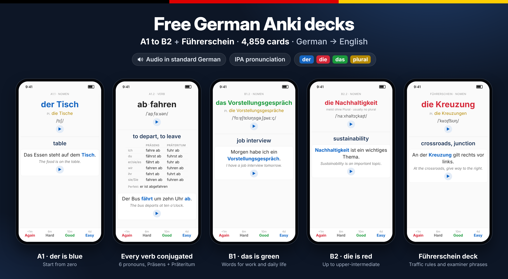

# German Vocabulary Anki Decks (A1 to B2, plus Führerschein)

Free German to English flashcards for [Anki](https://apps.ankiweb.net/), the spaced-repetition app. They're for anyone learning German in their free time who wants to feel at home in Germany: at work, with neighbours, at the Bürgeramt, or behind the wheel.

- **4,859 cards** in 9 decks, from A1 (complete beginner) to B2
- **Audio on every card:** the word and the example sentence, in clear standard German (Hochdeutsch)
- **Colour-coded articles:** 🔵 **der** is blue, 🔴 **die** is red, 🟢 **das** is green, 🟡 plurals are yellow
- **Full verb tables:** present and simple past for all six persons, plus the Perfekt
- **A bonus deck for driving lessons and the German driving licence (Führerschein)**

  

---

## The decks

| Deck | Level | Cards | Download |
|---|---|---|---|
| Deutsch::A1.1 | Beginner, part 1 | 394 | [Deutsch_A1_1.apkg](https://github.com/salemsajjad/german-anki-decks/raw/main/decks/Deutsch_A1_1.apkg) |
| Deutsch::A1.2 | Beginner, part 2 | 393 | [Deutsch_A1_2.apkg](https://github.com/salemsajjad/german-anki-decks/raw/main/decks/Deutsch_A1_2.apkg) |
| Deutsch::A2.1 | Elementary, part 1 | 320 | [Deutsch_A2_1.apkg](https://github.com/salemsajjad/german-anki-decks/raw/main/decks/Deutsch_A2_1.apkg) |
| Deutsch::A2.2 | Elementary, part 2 | 320 | [Deutsch_A2_2.apkg](https://github.com/salemsajjad/german-anki-decks/raw/main/decks/Deutsch_A2_2.apkg) |
| Deutsch::B1.1 | Intermediate, part 1 | 765 | [Deutsch_B1_1.apkg](https://github.com/salemsajjad/german-anki-decks/raw/main/decks/Deutsch_B1_1.apkg) |
| Deutsch::B1.2 | Intermediate, part 2 | 765 | [Deutsch_B1_2.apkg](https://github.com/salemsajjad/german-anki-decks/raw/main/decks/Deutsch_B1_2.apkg) |
| Deutsch::B2.1 | Upper intermediate, part 1 | 776 | [Deutsch_B2_1.apkg](https://github.com/salemsajjad/german-anki-decks/raw/main/decks/Deutsch_B2_1.apkg) |
| Deutsch::B2.2 | Upper intermediate, part 2 | 776 | [Deutsch_B2_2.apkg](https://github.com/salemsajjad/german-anki-decks/raw/main/decks/Deutsch_B2_2.apkg) |
| Deutsch::Führerschein | Driving licence (any level) | 350 | [Deutsch_Fuehrerschein.apkg](https://github.com/salemsajjad/german-anki-decks/raw/main/decks/Deutsch_Fuehrerschein.apkg) |

Each level is split into two halves by how common the words are, so the **.1** deck of each level holds the most frequent words. The A1 to B2 decks don't repeat words (except a handful that come back with a clearly different meaning), so you can import all of them. The Führerschein deck reuses some everyday words with driving examples.

### Where the words come from

- **A1, A2 and B1:** the official word lists of the Goethe-Institut exams (Goethe-Zertifikat A1, A2 and B1), including their themed word groups (numbers, months, family, jobs and so on). The big textbooks (Menschen, Schritte, Netzwerk) are written to cover this vocabulary.
- **B2:** the Goethe-Institut doesn't publish an official B2 list, so this deck combines the most frequent words beyond B1 (from spoken and written German) with the B2 exam topics: work and careers, health, environment, media and technology, society and politics, economy, housing and law. It also covers writing connectors (*infolgedessen*, *hinsichtlich*), fixed noun-verb phrases (*zur Verfügung stellen*, *in Kraft treten*) and verbs with their prepositions (*sich verlassen auf*).
- **Führerschein:** car parts and controls, road types and traffic signs, the rules you need for the theory test (right of way, speed limits, stopping distance), the basic manoeuvres of the practical test, and the sentences that examiners and driving instructors actually say (*"Halten Sie bitte am rechten Fahrbahnrand."*). Useful whether you're taking lessons from scratch or converting a foreign licence.

---

## What's on a card

**Front (German)**
- The word with its article, coloured by gender: der = blue, die = red, das = green. The plural form (*die Tische*) and nouns that only exist in the plural (*die Eltern*) are yellow.
- The plural form (*die Tische*)
- The pronunciation in IPA (*/tɪʃ/*)
- Audio of the word, which plays automatically. For nouns it says the singular and the plural: *"der Tisch, die Tische"*.

**Back (English)**
- The English meaning
- Grammar notes: the case or preposition a word takes (*helfen + Dat*, *warten auf + Akk*) and irregular comparatives (*gut, besser, am besten*)
- **Verbs:** a table with all six persons in Präsens and Präteritum, plus the Perfekt (*er ist abgefahren*). Separable verbs are shown as *ab·fahren*.
- An example sentence with the word highlighted, its English translation, and audio

---

## How to import the decks

You need the free Anki app. Download the `.apkg` files you want from the table above, then follow the steps for your device. You can import one deck or all nine; they all appear under a parent deck called **Deutsch**.

### Android (AnkiDroid, free)

1. Install [AnkiDroid](https://play.google.com/store/apps/details?id=com.ichi2.anki) from Google Play.
2. Download a deck file from the table above.
3. Open AnkiDroid, tap the **three-dot menu (⋮)** in the top-right corner, then **Import** → **Deck package (.apkg)**.
4. Choose the file from your **Downloads** folder and confirm.

Tapping the file in a file manager also works on many phones, but some file managers don't offer AnkiDroid. If that happens, use the import menu in step 3.

> **File greyed out or won't import?** Some phones rename the download to `.zip` or `.apkg.zip`. Rename it so it ends in exactly `.apkg` and try again.

### iPhone and iPad

**Option A: AnkiMobile (paid app)**
1. Install **AnkiMobile Flashcards** from the App Store. It's the official Anki app for iOS and its sales fund Anki's development.
2. Download a deck file in Safari. It is saved to the **Files** app (Downloads folder).
3. Open the **Files** app and tap the `.apkg` file. It opens in AnkiMobile.
4. Tap **Import**.

**Option B: free, through AnkiWeb**
1. Import the decks on a computer with Anki Desktop (see below).
2. Create a free account at [ankiweb.net](https://ankiweb.net) and press **Sync** in Anki Desktop.
3. On your iPhone, open [ankiweb.net](https://ankiweb.net) in Safari, log in, and study in the browser.

### Desktop (Windows, macOS, Linux)

1. Install Anki from [apps.ankiweb.net](https://apps.ankiweb.net/). It's free.
2. Double-click a downloaded `.apkg` file, or open Anki and choose **File → Import** and select the file.
3. Click **Import**.

### Studying on several devices

Make a free [AnkiWeb](https://ankiweb.net) account and press **Sync** on each device. Your decks and progress stay the same on your phone and computer.

---

## How to use them

- **Pick your level.** If you're a beginner, start with A1.1 and only add the next deck when the current one feels easy. If you already have some German, start one level below where you think you are and suspend the cards you already know (open the card's menu during review and choose **Suspend**).
- **Go slowly.** 10 to 20 new cards a day is plenty. Anki shows you old cards again just before you would forget them, so daily reviews matter more than new cards. You can change the number in the deck options.
- **Use your ears and voice.** Listen to the audio, repeat the word and the example sentence out loud, and say the article every time (*"der Tisch"*, not just *"Tisch"*). The colour helps you remember it.
- **Driving licence:** the Führerschein deck works at any level, but it's easier once you've done A2.

---

## Found a mistake? Want something added?

Please tell me through **GitHub Issues** (you need a free GitHub account):

👉 **[Open an issue](https://github.com/salemsajjad/german-anki-decks/issues/new/choose)**

You'll see two forms:

- **Card error:** a wrong translation, article, plural, verb form, example sentence, pronunciation or audio. Please include the deck and the German word, so I can find the card quickly.
- **Suggestion or request:** a missing word, a new topic deck, another translation language, or an idea for the card design.

You can also look at the [existing issues](https://github.com/salemsajjad/german-anki-decks/issues) first, in case someone has already reported the same thing. Fixes are released as new versions of the deck files.

**Updating:** download the new file and import it again. Cards are matched by an internal ID, so in current versions of Anki the existing cards are updated in place and your review progress is kept.

**Latest update (November 2026):** the article colours now follow the scheme many German courses use: der is blue, die is red, das is green and plurals are yellow. If you imported an earlier version, import the new files again to get the new colours. Your review progress is kept.

If these decks help you, please ⭐ **star this repository** and share it with someone who is learning German.

---

## Notes

- The cards were created with the help of AI. Articles and plurals were checked against Wiktionary data, every verb conjugation was checked against the official Goethe-Institut verb forms, and the example sentences were written for these decks (they are not copied from the Goethe lists). Mistakes are still possible, so please report them.
- The audio is a computer-generated (neural) German voice, not a recording of a person. It is clear and natural-sounding, but stress on long or rare compound words can occasionally be slightly off.
- English translations use British spelling.

## Credits and licence

- Word selection for A1 to B1: the official word lists of the [Goethe-Institut](https://www.goethe.de/) exams (Goethe-Zertifikat A1, A2 and B1). Only the choice of words is used; definitions and examples are original.
- Pronunciation (IPA): [german-ipa-dict](https://github.com/devio-at/german-ipa-dict) by devio-at, based on Wiktionary, via [ipa-dict](https://github.com/open-dict-data/ipa-dict) (CC BY-SA)
- Noun genders and plurals were checked with [german-nouns](https://github.com/gambolputty/german-nouns) (Wiktionary data)
- Voice: [Thorsten-Voice](https://github.com/thorstenMueller/Thorsten-Voice) (CC0) via the [Piper](https://github.com/rhasspy/piper) text-to-speech engine
- Word frequencies: [FrequencyWords](https://github.com/hermitdave/FrequencyWords) (OpenSubtitles) and [wikipedia-word-frequency](https://github.com/IlyaSemenov/wikipedia-word-frequency)

The decks are released under the **[Creative Commons Attribution-ShareAlike 4.0](LICENSE)** licence (CC BY-SA 4.0). You may share and adapt them, including for teaching, as long as you credit this repository and share your changes under the same licence.

Made by [Sajjad Salem](https://github.com/salemsajjad). Viel Erfolg beim Deutschlernen! 🇩🇪
