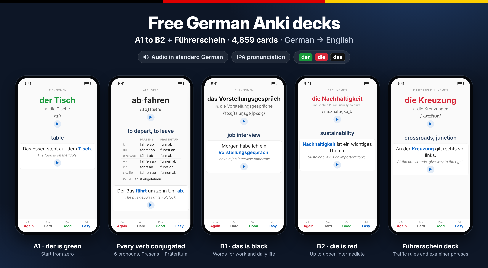

# German Vocabulary Decks for Anki

German to English flashcards from CEFR level A1 to B2, 
with an additional deck for the German driving licence (Führerschein).

[Download](#download) · [Installation](#installation) · [Card layout](#card-layout) · [Sources and quality](#sources-and-quality) · [Feedback](#feedback)

  

## Overview

This repository provides nine ready-to-import [Anki](https://apps.ankiweb.net/) decks with 4,859 cards for learners of German. The vocabulary follows the CEFR levels used by German courses and exams, and a separate deck covers the language of driving lessons and the driving test. The decks are free to use and share.

| Feature | Description |
|---|---|
| Audio | Every card has audio for the word and for the example sentence, in standard German (Hochdeutsch). |
| Pronunciation | IPA transcription for every word. |
| Grammatical gender | Articles are colour-coded: *der* green, *die* red, *das* black. |
| Verbs | Präsens and Präteritum for all six persons, plus the Perfekt. Separable verbs are marked (*ab·fahren*). |
| Grammar notes | Case and preposition government (*helfen + Dat*, *warten auf + Akk*) and irregular comparatives. |
| Examples | One example sentence per word, with English translation. |

## Quick start

1. Install Anki on your device (see [Installation](#installation)).
2. Download one or more decks from the table below.
3. Import the `.apkg` file. All decks appear under a parent deck called **Deutsch**.

## Download

| Deck | CEFR level | Cards | File |
|---|---|---:|---|
| Deutsch::A1.1 | A1, Beginner (part 1) | 394 | [Deutsch_A1_1.apkg](https://github.com/salemsajjad/german-anki-decks/raw/main/decks/Deutsch_A1_1.apkg) |
| Deutsch::A1.2 | A1, Beginner (part 2) | 393 | [Deutsch_A1_2.apkg](https://github.com/salemsajjad/german-anki-decks/raw/main/decks/Deutsch_A1_2.apkg) |
| Deutsch::A2.1 | A2, Elementary (part 1) | 320 | [Deutsch_A2_1.apkg](https://github.com/salemsajjad/german-anki-decks/raw/main/decks/Deutsch_A2_1.apkg) |
| Deutsch::A2.2 | A2, Elementary (part 2) | 320 | [Deutsch_A2_2.apkg](https://github.com/salemsajjad/german-anki-decks/raw/main/decks/Deutsch_A2_2.apkg) |
| Deutsch::B1.1 | B1, Intermediate (part 1) | 765 | [Deutsch_B1_1.apkg](https://github.com/salemsajjad/german-anki-decks/raw/main/decks/Deutsch_B1_1.apkg) |
| Deutsch::B1.2 | B1, Intermediate (part 2) | 765 | [Deutsch_B1_2.apkg](https://github.com/salemsajjad/german-anki-decks/raw/main/decks/Deutsch_B1_2.apkg) |
| Deutsch::B2.1 | B2, Upper intermediate (part 1) | 776 | [Deutsch_B2_1.apkg](https://github.com/salemsajjad/german-anki-decks/raw/main/decks/Deutsch_B2_1.apkg) |
| Deutsch::B2.2 | B2, Upper intermediate (part 2) | 776 | [Deutsch_B2_2.apkg](https://github.com/salemsajjad/german-anki-decks/raw/main/decks/Deutsch_B2_2.apkg) |
| Deutsch::Führerschein | Driving licence, any level | 350 | [Deutsch_Fuehrerschein.apkg](https://github.com/salemsajjad/german-anki-decks/raw/main/decks/Deutsch_Fuehrerschein.apkg) |

- Each level is split into two parts by word frequency: part 1 contains the most common words.
- The A1 to B2 decks do not repeat words, except a few that return with a clearly different meaning, so all of them can be imported together. The Führerschein deck reuses some everyday words with driving-related examples.
- To download every deck at once, choose **Code → Download ZIP** on this page.

## Installation

| Platform | App | Cost |
|---|---|---|
| Android | [AnkiDroid](https://play.google.com/store/apps/details?id=com.ichi2.anki) | Free |
| iPhone and iPad | AnkiMobile Flashcards (App Store) | Paid, or free in the browser through [AnkiWeb](https://ankiweb.net) |
| Windows, macOS, Linux | [Anki](https://apps.ankiweb.net/) | Free |

<strong>Android (AnkiDroid)</strong>

1. Install AnkiDroid from Google Play.
2. Download a deck file from the [Download](#download) table.
3. In AnkiDroid, open the **⋮** menu in the top-right corner and choose **Import → Deck package (.apkg)**.
4. Select the file from your **Downloads** folder and confirm.

Some file managers do not offer AnkiDroid when you tap an `.apkg` file. Use the import menu in step 3 instead. If the file is greyed out, your phone may have renamed it to `.zip` or `.apkg.zip`; rename it so that it ends in `.apkg`.

<strong>iPhone and iPad</strong>

**AnkiMobile (paid, official app)**

1. Install AnkiMobile Flashcards from the App Store. Its sales fund the development of Anki.
2. Download a deck file in Safari. It is saved to the **Files** app, in the Downloads folder.
3. Open the **Files** app and tap the `.apkg` file. It opens in AnkiMobile.
4. Tap **Import**.

**AnkiWeb (free, in the browser)**

1. Import the decks on a computer with Anki Desktop.
2. Create a free account at [ankiweb.net](https://ankiweb.net) and select **Sync** in Anki Desktop.
3. On the iPhone, open [ankiweb.net](https://ankiweb.net) in Safari, log in and study in the browser.

<strong>Desktop (Windows, macOS, Linux)</strong>

1. Install Anki from [apps.ankiweb.net](https://apps.ankiweb.net/).
2. Double-click a downloaded `.apkg` file, or open Anki and choose **File → Import**.
3. Select **Import**.

**Syncing between devices:** create a free [AnkiWeb](https://ankiweb.net) account and select **Sync** on each device. Decks and review progress then stay identical on your phone and computer.

## Card layout

| Side | Content |
|---|---|
| Front | The word with its article in colour, the plural form, the IPA transcription and the word audio (plays automatically; nouns are read with their plural, for example *der Tisch, die Tische*). |
| Back | The English meaning, grammar notes, the verb table for verbs, and an example sentence with its translation and audio. |

| Article | Colour |
|---|---|
| der (masculine) | Green |
| die (feminine) | Red |
| das (neuter) | Black (white in dark mode) |
| Plural-only nouns (*die Eltern*) | Purple |

## Sources and quality

**Vocabulary selection**

- **A1, A2 and B1:** the official word lists of the Goethe-Institut exams (Goethe-Zertifikat A1, A2 and B1), including their thematic word groups. Major course books such as *Menschen*, *Schritte* and *Netzwerk* are written to cover this vocabulary.
- **B2:** no official B2 list is published, so the deck combines the most frequent words beyond B1 in spoken and written German with the B2 exam topics (work, health, environment, media, society, economy, housing and law). It also covers connectors (*infolgedessen*, *hinsichtlich*), noun-verb collocations (*zur Verfügung stellen*, *in Kraft treten*) and verbs with prepositions (*sich verlassen auf*).
- **Führerschein:** car parts and controls, road types and traffic signs, the rules required for the theory test (right of way, speed limits, stopping distance), the manoeuvres of the practical test, and the instructions examiners and driving instructors use (*Halten Sie bitte am rechten Fahrbahnrand.*). The deck suits both new learners and drivers converting a foreign licence.

**Quality checks**

- Articles and plurals were checked against Wiktionary data.
- Verb conjugations are generated by a rule-based engine with a table of irregular verbs, tested against the 591 verb forms given in the official Goethe-Institut word lists.
- Example sentences were written for these decks and are not copied from the Goethe-Institut lists.
- The cards were created with the help of AI. Errors are still possible; please report any you find.

**Known limitations**

- The audio uses a neural text-to-speech voice, not a human recording. It is clear and natural, but the stress of long or rare compound words can occasionally be slightly off.
- English translations use British spelling.

## Recommended use

- **Choose a starting level.** Beginners should start with A1.1 and add the next deck when the current one feels comfortable. Learners with some German can start one level below their estimated level and suspend cards they already know (**Suspend** in the card menu during review).
- **Limit new cards.** 10 to 20 new cards per day is a sustainable pace. Daily reviews matter more than new cards. The limit can be changed in the deck options.
- **Practise aloud.** Listen to the audio, repeat the word and the example sentence, and always say the article together with the noun.
- **Führerschein deck.** It can be studied at any level, but is easier after A2.

## Feedback

Corrections and suggestions are welcome through [GitHub Issues](https://github.com/salemsajjad/german-anki-decks/issues/new/choose). A free GitHub account is required. Two forms are available:

| Form | Use it for |
|---|---|
| Card error | A wrong translation, article, plural, verb form, example sentence, pronunciation or audio. Please include the deck and the German word. |
| Suggestion or request | A missing word, a new topic deck, another translation language, or a change to the card design. |

Please check the [existing issues](https://github.com/salemsajjad/german-anki-decks/issues) before opening a new one.

**Updates:** corrected versions are published as new deck files. Download the new file and import it again. In current versions of Anki, existing cards are updated in place and your review progress is kept.

If you find this project useful, please consider starring the repository and sharing it with other learners.

## Acknowledgements

- Word selection for A1 to B1: official word lists of the [Goethe-Institut](https://www.goethe.de/) exams. Only the selection of words is used; definitions and examples are original.
- Pronunciation: [german-ipa-dict](https://github.com/devio-at/german-ipa-dict) by devio-at, based on Wiktionary, via [ipa-dict](https://github.com/open-dict-data/ipa-dict) (CC BY-SA).
- Noun genders and plurals: [german-nouns](https://github.com/gambolputty/german-nouns) (Wiktionary data).
- Voice: [Thorsten-Voice](https://github.com/thorstenMueller/Thorsten-Voice) (CC0) with the [Piper](https://github.com/rhasspy/piper) text-to-speech engine.
- Word frequencies: [FrequencyWords](https://github.com/hermitdave/FrequencyWords) (OpenSubtitles) and [wikipedia-word-frequency](https://github.com/IlyaSemenov/wikipedia-word-frequency).

## Licence

The decks are released under the [Creative Commons Attribution-ShareAlike 4.0 International](LICENSE) licence (CC BY-SA 4.0). You may share and adapt them, including for teaching, provided that you credit this repository and distribute your changes under the same licence.

---

Maintained by <a href="https://github.com/salemsajjad">Sajjad Salem</a>

